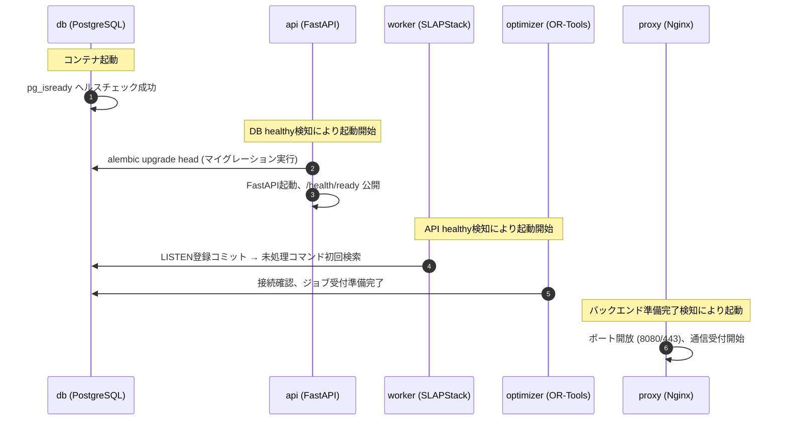
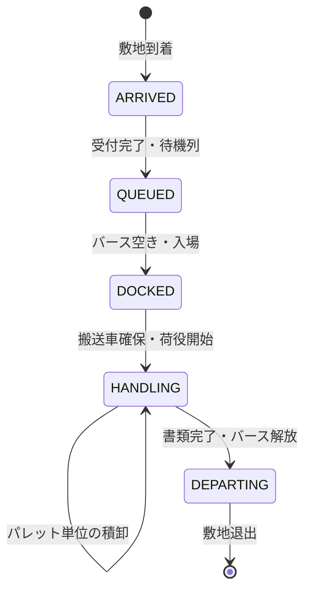
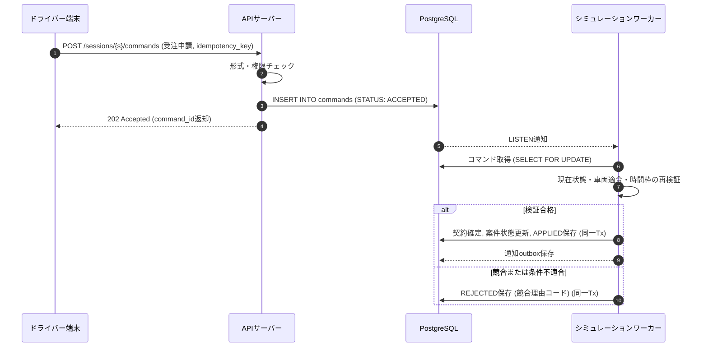
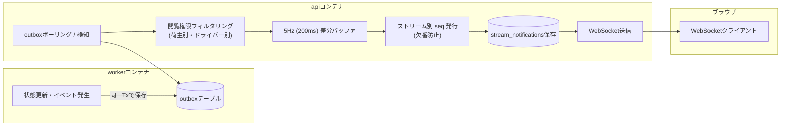

# SLAPStack物流シミュレーション基盤設計書
## VRPBによる帰り荷計画と多人数参加型の倉庫運営

**版**: 1.1  
**作成日**: 2026年10月16日  
**改訂日**: 2026年10月16日  

---

### 改訂履歴

| 版 | 日付 | 改訂内容 |
|---|---|---|
| 1.0 | 2026年10月16日 | 初版作成（基本設計および主要詳細設計の策定） |
| 1.1 | 2026年10月16日 | **具現化・実装方針の確定（Docker Compose基盤）**<br>・Docker Compose構成（通常運用5サービス／開発時6サービス）の確定<br>・各コンポーネントの技術スタック（FastAPI, React+TS, SQLAlchemy 2.x, psycopg 3, Nginx, Alembic, OR-Tools）の確定<br>・DB永続コマンドキュー＋LISTEN/NOTIFYによるAPI↔ワーカー連携設計の具現化<br>・非同期ジョブ受付型によるワーカー↔最適化サービス連携設計の確定（解状態と終了理由の分離）<br>・ストリーム分離型WebSocket通知配信アーキテクチャ（API集約・5Hz差分化・再同期）の確定<br>・起動順序・ヘルスチェック（depends_on + service_healthy）・マイグレーション運用方針の確定 |

---

## 目次

1. [設計方針](#1-設計方針)
2. [要件と対象範囲](#2-要件と対象範囲)
   - 2.1 [必須要件](#21-必須要件)
   - 2.2 [初期シナリオ](#22-初期シナリオ)
3. [ローカルシステム構成（Docker Compose）](#3-ローカルシステム構成docker-compose)
   - 3.1 [サービス構成とコンテナ責務](#31-サービス構成とコンテナ責務)
   - 3.2 [Docker Composeファイル構成と起動運用](#32-docker-composeファイル構成と起動運用)
   - 3.3 [ネットワーク構成とセキュリティ](#33-ネットワーク構成とセキュリティ)
   - 3.4 [データ永続化・ボリューム・バックアップ](#34-データ永続化ボリュームバックアップ)
   - 3.5 [起動シーケンスとヘルスチェック制御](#35-起動シーケンスとヘルスチェック制御)
4. [SLAPStackの利用境界](#4-slapstackの利用境界)
   - 4.1 [既存機能と追加部分](#41-既存機能と追加部分)
   - 4.2 [採用する拡張方式と環境選定](#42-採用する拡張方式と環境選定)
5. [シミュレーション時刻とイベント](#5-シミュレーション時刻とイベント)
   - 5.1 [時計の定義](#51-時計の定義)
   - 5.2 [同時刻の処理順](#52-同時刻の処理順)
   - 5.3 [人間の操作待ち](#53-人間の操作待ち)
   - 5.4 [早着と遅延の入力](#54-早着と遅延の入力)
6. [利用者とフロントエンド](#6-利用者とフロントエンド)
   - 6.1 [入口と参加モデル](#61-入口と参加モデル)
   - 6.2 [主要画面](#62-主要画面)
7. [倉庫と荷役のモデル](#7-倉庫と荷役のモデル)
   - 7.1 [トラックと倉庫の接続](#71-トラックと倉庫の接続)
   - 7.2 [資源制約と割当](#72-資源制約と割当)
8. [VRPBの数理モデル](#8-vrpbの数理モデル)
   - 8.1 [適用する問題](#81-適用する問題)
   - 8.2 [必須制約](#82-必須制約)
   - 8.3 [時間枠と目的](#83-時間枠と目的)
9. [OR-Toolsによる計画生成](#9-or-toolsによる計画生成)
   - 9.1 [配送と帰り荷の計画](#91-配送と帰り荷の計画)
   - 9.2 [バースと倉庫待ちの計画](#92-バースと倉庫待ちの計画)
   - 9.3 [最適化サービスの非同期連携設計](#93-最適化サービスの非同期連携設計)
10. [計画と実績の連携](#10-計画と実績の連携)
    - 10.1 [再計画の契機](#101-再計画の契機)
    - 10.2 [受注を確定する手順](#102-受注を確定する手順)
    - 10.3 [遅延が帰り荷へ波及する例](#103-遅延が帰り荷へ波及する例)
11. [状態遷移と整合性](#11-状態遷移と整合性)
    - 11.1 [主要な状態](#111-主要な状態)
    - 11.2 [常に守る条件](#112-常に守る条件)
    - 11.3 [例外の扱い](#113-例外の扱い)
12. [データベース設計とアクセス制御](#12-データベース設計とアクセス制御)
    - 12.1 [テーブル群と制約](#121-テーブル群と制約)
    - 12.2 [DBアクセス層スタックとトランザクション境界](#122-dbアクセス層スタックとトランザクション境界)
    - 12.3 [排他・占有制御とマイグレーション運用](#123-排他占有制御とマイグレーション運用)
13. [APIと同時操作](#13-apiと同時操作)
    - 13.1 [画面向け契約](#131-画面向け契約)
    - 13.2 [競合制御とエラーハンドリング](#132-競合制御とエラーハンドリング)
    - 13.3 [ストリーム分離型WebSocket配信アーキテクチャ](#133-ストリーム分離型websocket配信アーキテクチャ)
14. [永続化と再現性](#14-永続化と再現性)
    - 14.1 [コミット境界](#141-コミット境界)
    - 14.2 [保存点](#142-保存点)
    - 14.3 [比較実験](#143-比較実験)
15. [運用と性能](#15-運用と性能)
    - 15.1 [ローカル運用](#151-ローカル運用)
    - 15.2 [負荷目標](#152-負荷目標)
    - 15.3 [監視項目](#153-監視項目)
16. [成績と検証シナリオ](#16-成績と検証シナリオ)
    - 16.1 [KPIの定義](#161-kpiの定義)
    - 16.2 [帰り荷の比較例](#162-帰り荷の比較例)
17. [受入条件と導入手順](#17-受入条件と導入手順)
    - 17.1 [受入試験](#171-受入試験)
    - 17.2 [実装に進む際の順序](#172-実装に進む際の順序)
    - 17.3 [実装前に確定する項目](#173-実装前に確定する項目)
18. [一次資料と調査記録](#18-一次資料と調査記録)

---

## 1 設計方針

1. **SLAPStackの統合**: SLAPStackを庫内搬送エンジンとして採用し、トラック運行・バース管理・受発注を追加する。
2. **ローカル完結型アーキテクチャ**: ローカルPC上にDocker Composeを用いてフロントエンド、リバースプロキシ、APIサーバー、シミュレーションワーカー、最適化サービス、PostgreSQLを配置する。荷主とドライバーは別のWeb入口から同じシミュレーションに参加し、操作と閲覧をブラウザで完結させる。
3. **帰り荷最適化**: 帰り荷の最適化にはGoogle OR-Toolsを用いる。往路配送を終えてから集荷し、出発拠点へ戻るVRPB（Vehicle Routing Problem with Backhauls）に時間枠を加え、倉庫での積込・荷下ろし待ちを計画に反映する。
4. **予測と実績の分離**: 運行計画は「予測」、シミュレーションの完了イベントは「実績」として明確に分離する。
5. **本書の範囲**: 本書は基本設計および主要な詳細設計を対象とし、コンテナ構成、通信仕様、DBアクセス制御、同時実行モデルを規定する。

---

## 2 要件と対象範囲

### 2.1 必須要件

| ID | 要件項目 | 内容 |
|---|---|---|
| R01 | 庫内シミュレーション | SLAPStackを用いてパレット格納・出庫・AGV搬送をシミュレートする |
| R02 | 帰り荷計画 (VRPB) | デポ出発→全配送先訪問→全集荷先訪問→デポ帰着の順序と時間枠を守る |
| R03 | バース・荷役連携 | トラック到着、バース待機、荷下ろし/積込、庫内搬送を連携させる |
| R04 | サービス分離構成 | リバースプロキシ、Web画面、API、シミュレーション、最適化、DBを分離する |
| R05 | 入口の分離 | `/shipper`（荷主）と `/driver`（ドライバー）の専用入口を設ける |
| R06 | 参加者の可変管理 | Userと参加Membershipを可変件数で保持し、途中参加も許容する |
| R07 | 操作の画面完結 | 参加、設定、受発注、運行指示、保存、再開をWeb画面から実行できる |
| R08 | 物流と最適化の連携 | バース遅延をETA、契約リスク、収支・利益に即座に伝播させる |

### 2.2 初期シナリオ

| 項目 | 初期値案 | 変更方法 |
|---|---|---|
| 詳細倉庫 | 1拠点（複数荷主が区画・在庫を共有） | シナリオ設定 |
| バース／搬送車 | 4基／3台 | 開始前に画面で設定 |
| トラック | 稼働20台を標準負荷とする | ユーザー数とは独立に追加 |
| 荷物 | パレット単位、重量(kg)も保持 | SKUとパレットごとに登録 |
| 時間倍率 | 60倍（1倍、10倍、一時停止も用意） | ホスト権限の画面から変更 |
| 営業時間 | 08:00〜18:00（10時間） | シナリオごとに設定 |
| 道路網・経路 | 拠点間の距離(m)と所要時間(秒)の行列 | CSV取込または画面編集 |

- 初期版は「単一デポ」「分割配送なし」「1台につき同時に1運行」を対象とする。
- 同じ車両の次の運行は帰庫・荷下ろし完了後に作成できる。
- 途中参加者には新しい資産を自動生成せず、荷主は既存組織への参加または新組織作成を選び、ドライバーは未割当車両を選択する。

---

## 3 ローカルシステム構成（Docker Compose）

### 3.1 サービス構成とコンテナ責務

本システムは、Docker Composeを用いたモノレポ構成とし、開発環境と通常運用環境でサービス構成を最適化する。

```mermaid
flowchart TD
    subgraph Browser ["利用者ブラウザ"]
        Shipper["荷主画面 (/shipper)"]
        Driver["ドライバー画面 (/driver)"]
        HostUI["管理画面 (/admin)"]
    end

    subgraph Host ["ホストマシン (Docker Compose)"]
        Proxy["proxy (Nginx)\n:8080 (HTTP) / :443 (HTTPS)"]
        
        subgraph DevOnly ["開発時のみ常駐 (compose.dev.yaml)"]
            FrontendDev["frontend (Vite Dev Server)\n:5173 (内部のみ)"]
        end

        subgraph CoreBackend ["内部サービス (ポート外部非公開)"]
            API["api (FastAPI, Python 3.12)\n認証・コマンド受付・WebSocket配信"]
            Worker["worker (Python 3.11)\nSLAPStack 0.1.1 + 業務イベント"]
            Optimizer["optimizer (FastAPI, Python 3.12)\nOR-Tools VRPB / CP-SAT"]
            DB[("db (PostgreSQL 16)\n永続化・コマンドキュー")]
        end
    end

    Shipper -->|HTTP / WebSocket| Proxy
    Driver -->|HTTP / WebSocket| Proxy
    HostUI -->|HTTP / WebSocket| Proxy

    Proxy -->|静的ファイル配信 (通常運用時)| Proxy
    Proxy -.->|画面・HMR転送 (開発時)| FrontendDev
    Proxy -->|/api 転送| API
    Proxy -->|/ws 転送| API

    API -->|1. コマンド保存 + NOTIFY| DB
    API -->|状態照会 / outbox取得| DB
    API -->|通知配信| Proxy

    Worker -->|2. LISTEN検知 + コマンド取得| DB
    Worker -->|3. 状態・イベント・outbox一括保存| DB
    Worker -->|4. 最適化依頼 POST /jobs (202)| Optimizer

    Optimizer -->|入力取得 & 計画結果保存| DB
```

#### サービス一覧と環境別構成

| サービス名 | 通常運用時 | 開発時 | 主要技術スタック | 責務 |
|---|---|---|---|---|
| `proxy` | 常駐 | 常駐 | Nginx (Alpine) | 単一のWeb入口。`/`の画面配信、`/api`・`/ws`のAPI転送、SSL終端 |
| `frontend` | **なし**（イメージビルド時にNginx内へ静的配置） | **常駐** | React 18, TypeScript, Vite, Zustand | UI画面のHot Module Replacement (HMR) 開発サーバー |
| `api` | 常駐 | 常駐 | Python 3.12, FastAPI, SQLAlchemy 2.x, psycopg 3 | 認証・認可、コマンド受付・検証、状態照会、WebSocket通知配信 |
| `worker` | 常駐 | 常駐 | Python 3.11, SLAPStack 0.1.1 (派生版), psycopg 3 | シミュレーション時計進行、SLAPStack制御、業務イベント処理、セッション占有 |
| `optimizer` | 常駐 | 常駐 | Python 3.12, FastAPI, Google OR-Tools | VRPB経路最適化、バースCP-SATスケジューリング計算ジョブの実行 |
| `db` | 常駐 | 常駐 | PostgreSQL 16 (Debian/Alpine) | 永続化データ、コマンドキュー、イベント履歴、通知outbox、保存スナップショット |

> [!NOTE]
> 通常運用時はビルド済みSPAをNginxコンテナが直接配信するため、常駐サービス数は**5サービス**となります。開発時はViteコンテナが加わり**6サービス**となります。

### 3.2 Docker Composeファイル構成と起動運用

設定の意図しない混入を防ぐため、自動読み込みされる `compose.override.yaml` は採用せず、明示的なファイル指定方式を採用する。

```
tof-logis/
├── compose.yaml              # 通常運用構成（5サービス、共通ネットワーク、ボリューム定義）
├── compose.dev.yaml          # 開発用追加構成（frontend追加、Nginx転送変更、Bind Mount）
├── .env.example              # 環境変数テンプレート
├── shared/                   # 共通Pydanticモデル・ドメイン型定義（Pythonパッケージ）
├── proxy/                    # Nginx設定ファイルおよびSSL証明書管理
├── frontend/                 # React SPAソースコード
├── api/                      # FastAPIサーバー実装
├── worker/                   # SLAPStackシミュレーションワーカー実装
├── optimizer/                # OR-Tools最適化サービス実装
└── db/                       # Alembicマイグレーションスクリプトおよび初期化SQL
```

#### 起動コマンド

```bash
# 通常運用環境の起動（5サービス、静的ビルド済みSPAをNginxから配信）
docker compose -f compose.yaml up -d --build

# 開発環境の起動（6サービス、Vite HMR有効、ソースコードのBind Mount同期）
docker compose -f compose.yaml -f compose.dev.yaml up -d --build

# 停止
docker compose -f compose.yaml down
```

### 3.3 ネットワーク構成とセキュリティ

1. **単一ブリッジネットワーク**: Docker Composeが作成する単一のデフォルトブリッジネットワークを使用する。
2. **ポート公開の最小化**:
   - ホストマシンおよびLANにポートを公開するのは **`proxy` サービスのみ** とする（開発時: `8080:80`、HTTPS運用時: `443:443`）。
   - `api`, `worker`, `optimizer`, `db`, `frontend` には `ports` を定義せず、外部からの直接アクセスを物理的に遮断する。
3. **認可によるアクセス制御**:
   - 「画面以外から接続できない」の保証は、ポートの隠蔽だけでなく、APIサーバー側のエンドポイント認可（HttpOnly Cookie、セッション検証、ロール認可）によって担保する。ブラウザ外から直接APIを叩かれた場合も不正な操作は拒否される。

### 3.4 データ永続化・ボリューム・バックアップ

| ボリューム種別 | マウント対象 | 用途・アクセス権限 |
|---|---|---|
| Named Volume: `pg_data` | `db:/var/lib/postgresql/data` | PostgreSQLデータベース永続領域 |
| Named Volume: `tls_certs` | `proxy:/etc/nginx/certs:ro` | HTTPS用サーバー証明書および秘密鍵（読み取り専用） |
| Bind Mount: `./backups` | `db:/backups` または管理ツール | `pg_dump` によるバックアップ取得・リストア領域 |

#### バックアップと復元の運用方針
- **整合性の確保**: セッション実行中のバックアップは、まずホスト管理コマンドで「セッション一時停止 → メモリ状態をDBへスナップショット確定」を実行した後に、`docker compose exec db pg_dump` により取得する。
- **全体バックアップ構成**:
  1. `db.dump`: PostgreSQLダンプファイル（シナリオ・セッション・確定イベント・スナップショット）
  2. `manifest.json`: 保存形式版（`snapshot_format_version`）、Alembicリビジョン、`engine_build_id`、Gitコミットハッシュ、乱数シード情報
- **安全な復元**: バックアップからの復元は、既存セッションへの上書きを行わず、**必ず新しい `session_id` としてインポート**するか、検証用の別DBインスタンスで検証を行う。

### 3.5 起動シーケンスとヘルスチェック制御

Compose v2の `depends_on` と `condition: service_healthy` を用いて、確実な起動順序を制御する。



#### ヘルスチェック定義規則
- **循環依存の排除**: `api` の `/health/ready` は「DB接続確認」および「Alembicマイグレーションの成功」のみを合否判定とし、`worker` や `optimizer` のヘルスチェックには依存させない。
- **ワーカーの起動シーケンス**: ワーカーは起動時、`LISTEN` 登録トランザクションをコミットした後に、`commands` テーブルの未処理コマンドを検索し、その後に通知待機ループへ入る（登録直後の競合・通知漏れを防止）。

---

## 4 SLAPStackの利用境界

### 4.1 既存機能と追加部分

SLAPStack（0.1.1）はブロック積み倉庫向けの離散事象シミュレーターであり、`SlapEnv` が `SlapCore` を内包する。既存の機能境界と本システムでの追加・拡張内容は以下の通りである。

| 対象機能 | 既存実装（SLAPStack） | 本システムでの拡張方針 |
|---|---|---|
| レイアウトと庫内経路 | 格納ブロック、入出庫ドック、AGV移動計算 | そのまま利用。任意形状への適合は初期化時に検証 |
| 格納・出庫判断 | 位置選択および既存戦略（Heuristic） | 合法操作一覧をAdapter経由で取得し、荷主権限・契約を検証後に適用 |
| 搬送車（AGV）割当 | `get_close_agv`（距離基準の自動選択） | **独自拡張**: 画面で指定された車両ID、予約状況、積載適合性を反映 |
| バース・受付・積卸 | **未実装**（ユースケース外） | **独自実装**: トラック到着・受付・バース入場・手許荷役イベントを追加 |
| イベント進行境界 | `step_no_action` / `step` による一括進行 | **独自拡張**: 1イベント単位の実行インターフェースを新設し外部イベントと同期 |
| 外部注文の動的追加 | 静的注文列の消化を前提 | **独自拡張**: 注文が尽きても終了せず、外部からの追加注文を即時登録 |
| 状態保存と再開 | pickle等による非互換シリアライズ | **独自拡張**: 行列・キュー・乱数状態を版管理付きJSON/バイナリ形式で保存 |

### 4.2 採用する拡張方式と環境選定

- **Python実行環境の選定**:
  - `worker` コンテナは **Python 3.11** を初期検証対象とする（SLAPStack 0.1.1固定コミットとの環境検証後にバージョンを確定）。
  - `api` および `optimizer` コンテナは、独立して **Python 3.12** を採用し、古いライブラリ依存が全体に波及するのを防ぐ。
- **WarehouseAdapterの設計**:
  上流ソースのGitコミットを固定し、差分を最小限に抑えた派生版を `WarehouseAdapter` 経由で操作する。
  ```python
  class WarehouseAdapter:
      def step_single_event(self) -> DomainEvent: ...
      def peek_next_event_time(self) -> int: ...
      def inject_transport_order(self, order: TransportOrder) -> None: ...
      def book_agv(self, agv_id: str, task_id: str) -> bool: ...
      def export_snapshot(self) -> dict: ...
      def restore_snapshot(self, snapshot: dict) -> None: ...
  ```

---

## 5 シミュレーション時刻とイベント

### 5.1 時計の定義

- **シミュレーション時刻**: セッション開始を `0` とする **整数ミリ秒（BIGINT ms）** で管理する。実世界の日時（例: 2026-10-16 09:00:00）はセッション開始日時とのオフセット表示として扱う。
- **単位変換**: SLAPStack内部の秒単位浮動小数点数との境界では、1ms単位へ切り上げを行い、変換規則を一貫させる。
- **進行倍率**: 実時間はUI応答と進行速度（等倍、10倍、60倍等）にのみ使用し、処理負荷によって追いつかない場合は**実効倍率を自動低下**させ、イベントのスキップや待機時間の省略は一切行わない。

### 5.2 同時刻の処理順

同一シミュレーション時刻で発生したイベントは、以下の「優先度（昇順）＋登録連番（昇順）」で順序を一意に決定する。時計の巻き戻りは禁止する。

| 優先度 | イベント分類 | 具体例 |
|---|---|---|
| **0** | 作業完了と資源解放 | 庫内搬送完了、トラック荷役完了、バース退出 |
| **1** | 外部状態変化 | 自走トラック到着、外部流入車の到着、案件公開 |
| **2** | 受理済み操作の適用 | 確定済み受注コマンド、バース手動指示、運行計画承認 |
| **3** | 割当と作業開始 | 搬送車予約、バース入場・荷役開始、トラック走行開始 |
| **4** | 期限判定と統計集計 | 時間枠遅延の確定、KPIサンプリング更新 |

### 5.3 人間の操作待ち

- 多人数モードでは、特定プレイヤーの入力待ちによるシミュレーション全体の停止は行わない。
- プレイヤーはあらかじめ配車方針・優先順位を事前設定（プリセット）でき、判断地点でワーカーが自動適用する。未設定の場合は既定ポリシー（先着順等）を適用する。
- 教育・検証用に、ホスト権限のみが実行可能な「全体一時停止モード」を提供する。

### 5.4 早着と遅延の入力

- **自走トラック**: 出発時刻＋区間所要時間（距離／基準速度 × 時間帯係数）から正確な到着時刻を算出する。
- **外部流入車**: 予約時刻に対して正規分布等の到着偏差（早着・遅着）を与える。
- 乱数シードはセッションごとに保存し、同じシードでの再現性を担保する。

---

## 6 利用者とフロントエンド

### 6.1 入口と参加モデル

- `/shipper`: 荷主向けポータル。自社在庫、案件登録、運賃管理、納品ETA監視。
- `/driver`: ドライバー向けポータル。担当車両状態、案件市場（受注申請）、運行ルート指示、収支。
- **権限管理**: ユーザーはセッション参加時に役割を選択し固定する。倉庫運営権限およびホスト権限は追加フラグとして管理する。

| 操作・情報 | 荷主 | ドライバー | 倉庫運営者 | ホスト管理者 |
|---|---|---|---|---|
| 案件作成・報酬設定 | 自社案件のみ | 不可 | 不可 | 全案件可能 |
| 受注申請 | 不可 | 担当車両のみ | 不可 | 任意可能 |
| 庫内在庫・パレット | 自社分のみ閲覧 | 契約貨物のみ | 全在庫閲覧・指示 | 全閲覧可能 |
| バース・搬送車割当 | 不可 | 不可 | 手動割当・指示 | 全変更可能 |
| 運行計画の作成・承認 | 自社貨物のETA閲覧 | 自分の運行のみ | 不可 | 全変更可能 |
| シミュレーション停止・速度変更 | 不可 | 不可 | 不可 | 可能 |

### 6.2 主要画面構成（React SPA）

1. **荷主ダッシュボード**: 自社案件一覧、出荷進捗、在庫区画マップ、コスト集計
2. **ドライバーダッシュボード**: 車両積載ゲージ、走行ルートマップ、運行ステップ承認、収支メーター
3. **案件市場（Job Market）**: 公開案件一覧（往路L／帰り荷B）、空車走行予測、推奨案件表示
4. **2D倉庫ビューアー**: バース占有状況、AGV走行軌跡、仮置き場パレット積載数、待ち行列
5. **運行・計画比較ビュー**: 手動計画とVRPB推奨案の比較、遅延影響タイムライン
6. **ホスト管理コンソール**: 参加者一覧、進行倍率変更、外乱注入、スナップショット保存・バックアップ

---

## 7 倉庫と荷役のモデル

### 7.1 トラックと倉庫の接続

トラック到着から退出までのライフサイクルを、倉庫の物理資源（バース・仮置き・搬送車）と厳密に紐付ける。



- 初期版では荷下ろし・積込みにも庫内AGV（3台）を共用する。
- `WarehouseAdapter` の共通予約表で搬送車を占有し、庫内移動との二重予約を防止する。
- トラックの出発条件は「予定パレットの荷役完了」「積荷の固定完了」「退出経路の確保」とし、荷下ろしパレットの棚格納完了を待たずに出発を許可する。

### 7.2 資源制約と割当

- **バース**: 車格（大型・中型）、荷役種別（積込専用・荷下ろし専用・兼用）の適合制約を持つ。1バースの同時実占有は最大1台。
- **仮置き場（Staging Area）**: パレット収容上限を持つ。仮置き場が満杯の場合は荷下ろしを待機させ、デッドロックを防止する。
- **割当ポリシー**: デフォルトは先着順（FIFO）。倉庫運営権限者による手動優先指定、または最適化による計画的バース割当が可能。

---

## 8 VRPBの数理モデル

### 8.1 適用する問題

単一デポを出発し、複数の配送先（Linehaul: $L$）に荷物を届けた後、帰り荷の集荷先（Backhaul: $B$）で荷物を集荷してデポへ戻る **拡張VRPB（時間枠付き・案件選択可能）** を解く。

### 8.2 必須制約

1. **順序制約**: 同一運行において、すべての配送先 $L$ の訪問を完了した後にのみ、集荷先 $B$ への訪問を許可する（$B \to L$ の遷移を厳密に禁止）。
2. **容量制約**:
   - 車両の積載パレット数 $q_p$ および積載重量 $q_w$ は、許容量 $Q_p, Q_w$ を常に超えてはならない。
   - 出発時の積載量は担当する全 $L$ の合計数量。配送ごとに減少し、集荷 $B$ ごとに増加する。
3. **時間枠制約**:
   - 各地点 $i$ での荷役開始時刻 $s_i$ は、時間枠 $[a_i, b_i]$ を満たす（$a_i \le s_i \le b_i$）。
   - 早着（$s_i < a_i$）の場合は待機を許可する。遅延（$s_i > b_i$）にはペナルティを課す。
4. **契約の不可分性**: 1案件の複数車両による分割配送は行わない。既契約案件は原則として訪問必須とする。

### 8.3 時間枠と目的関数

目的関数は、追加運行利益の最大化（総費用の最小化）とする。

$$\max \sum_{j \in \text{SelectedJobs}} \text{Revenue}_j - \left( \sum \text{DistanceCost} + \sum \text{TimeCost} + \sum \text{TardinessPenalty} \right)$$

---

## 9 OR-Toolsによる計画生成

### 9.1 配送と帰り荷の計画

Google OR-Tools Routing Library を用いて求解する。

- **積載モデル**: 出発時積載を0固定とせず、担当配送量に一致させた初期積載変数を定義する。
- **順序制約の実装**: 配送フェーズ（値0）から集荷フェーズ（値1）への単調増加ディメンションを定義し、フェーズ0からフェーズ1への一方通行遷移を強制する。
- **案件選択**: 公開案件にはドロップペナルティ（未選択時の機会損失）を設定し、利益最大化問題を最短経路・費用最小化問題に変換する。

### 9.2 バースと倉庫待ちの計画

バースでの荷役重複回避には、OR-Tools CP-SAT を用いてトラック荷役を区間変数（Interval Var）、バースを排他資源（NoOverlap）としてモデル化する。

### 9.3 最適化サービスの非同期連携設計

シミュレーションの進行を最適化計算の待ち時間でブロックさせないため、**ジョブ受付型の非同期通信**を採用する。

```mermaid
sequenceDiagram
    autonumber
    participant Worker as シミュレーションワーカー
    participant DB as PostgreSQL (plans, jobs)
    participant Opt as 最適化サービス (FastAPI)

    Worker->>DB: 1. 状態スナップショット・対象・計算期限を保存
    Worker->>Opt: 2. POST /optimization-jobs (job_id)
    Opt-->>Worker: 3. 202 Accepted (即時応答)
    Note over Worker: シミュレーションイベント処理を継続進行
    Note over Opt: バックグラウンドでOR-Tools計算実行
    Opt->>DB: 4. 計画候補・解の状態・終了理由・計算時間を保存
    Worker->>DB: 5. ポーリングまたは定期契機で完了確認
    Worker->>Worker: 6. 現在状態（最新state_version）で再検証
    alt 制約を満たす
        Worker->>DB: 7a. 計画確定 (APPLIED)
    else 状況変化で不整合
        Worker->>DB: 7b. 計画失効 (STALE/REJECTED)
    end
```

#### 解の状態と終了理由の分離管理

計算結果は以下の2軸でDB（`optimizer_runs`）へ記録する。

- **解の状態（Solution Status）**:
  - `OPTIMAL`: 最適解
  - `FEASIBLE`: 可行解（改善の余地あり）
  - `INFEASIBLE`: 実行不可能（制約充足不能）
  - `UNKNOWN`: 解なし
- **終了理由（Termination Reason）**:
  - `COMPLETED`: 探索完了
  - `TIME_LIMIT`: 計算制限時間到達（自動運用時5秒、比較実験時30秒）
  - `CANCELLED`: キャンセル
  - `ERROR`: 内部例外

> [!IMPORTANT]
> `FEASIBLE + TIME_LIMIT` の組み合わせ（時間切れだが有効な暫定解あり）を正確に扱い、可行解が得られたに過ぎない場合に「OPTIMAL」と誤表示しない。また、HTTPタイムアウトとソルバー計算時間制限は明確に分離する。

---

## 10 計画と実績の連携

### 10.1 再計画の契機

以下のイベント発生時に、影響を受ける未着手運行区間の再計画をトリガーする。
- 新規案件の公開、他ドライバーによる受注成立
- バース到着遅延、荷役時間の大幅な延伸
- シミュレーション内5分経過ごとの定期見直し

### 10.2 受注を確定する手順



### 10.3 遅延が帰り荷へ波及する例

1. 名古屋での往路配送Aの完了予定が14:30、帰り荷Bの集荷開始時間枠が15:00〜16:00とする（移動20分）。
2. Aのバース混雑により荷下ろし完了が15:50に遅延した場合、Bへの到着予想は16:10となり時間枠（16:00）を10分超過する。
3. システムはこの遅延を即座に検知し、未受注のBは市場候補から除外、受注済みのBに対しては違反見込みフラグを立てて救済計画（再配車またはペナルティ計算）を生成する。

---

## 11 状態遷移と整合性

### 11.1 主要な状態

| 対象エンティティ | 状態遷移パス | 終了・例外状態 |
|---|---|---|
| **案件 (Job)** | `DRAFT` → `OPEN` → `CONTRACTED` → `IN_PROGRESS` → `COMPLETED` | `CANCELLED`, `FAILED` |
| **バース訪問 (Visit)** | `PLANNED` → `ARRIVED` → `QUEUED` → `DOCKED` → `HANDLING` → `RELEASED` | `SKIPPED`, `ABORTED` |
| **トラック (Truck)** | `AVAILABLE` → `LOADING` → `TRAVELLING` → `WAITING` → `HANDLING` → `RETURNING` | `OUT_OF_SERVICE` |
| **パレット (Pallet)** | `STORED` → `RESERVED` → `IN_TRANSIT` → `STAGED` → `ON_TRUCK` → `DELIVERED` | `DAMAGED`, `LOST` |
| **搬送車 (AGV)** | `IDLE` → `RESERVED` → `TRAVELLING` → `HANDLING` → `IDLE` | `OUT_OF_SERVICE` |
| **計画提案 (Plan)** | `PROPOSED` → `VALIDATING` → `APPLIED` | `STALE`, `REJECTED`, `EXPIRED` |

### 11.2 常に守る整合性条件（不変条件）

1. **パレットの物理唯一性**: パレットは「保管区画」「仮置き」「搬送中」「トラック上」「引渡済み」のいずれか厳密に1箇所にのみ存在する。
2. **排他資源の二重占有禁止**: 1つのバースの実占有トラックは最大1台。1台の搬送車の同時作業は最大1件。
3. **引当可能数制約**: 予約可能数量は在庫引当可能数量を超えない。異なる荷主の同一SKUを混同しない。
4. **単調増加性**: 全体時刻、イベント連番（`event_seq`）、状態バージョン（`state_version`）は単調に増加し、巻き戻らない。
5. **台帳の完全性**: 運賃支払と貨物移動はすべて案件IDと紐づき、二重計上を防止する。

---

## 12 データベース設計とアクセス制御

### 12.1 テーブル群と制約

すべてのシミュレーションデータは `session_id` を持ち、マルチテナント的に分離される。

| テーブル分類 | テーブル名 | 主要カラムと制約 |
|---|---|---|
| 認証・セッション | `users`, `auth_sessions`, `sessions`, `memberships` | `session_id + user_id` での一意制約、参加役割、追加権限 |
| 組織・施設 | `organizations`, `facilities`, `docks`, `staging_areas` | 荷主組織、倉庫・デポ拠点、バース仕様、仮置き上限容量 |
| 車両・荷役機材 | `trucks`, `driver_assignments`, `forklifts`, `warehouse_tasks` | 車両諸元、担当期間、AGV状態、庫内タスクとSLAPStack注文ID |
| 貨物・在庫 | `skus`, `pallets`, `reservations` | 荷主ID、重量(g)、現在位置種別・ID、予約ロック |
| 案件・契約 | `jobs`, `contracts` | 往路L/帰り荷B、発着地、時間枠、報酬(円)、**有効契約の部分一意インデックス** |
| 運行・実績 | `routes`, `route_stops`, `visits` | 運行計画版、予定/実績訪問順、予実時刻(ms)、荷役パレット数 |
| コマンド・イベント | `commands`, `domain_events` | `session_id + user_id + idempotency_key` 一意制約、`event_seq` 一意 |
| 最適化・計画 | `plans`, `optimizer_runs` | 基準状態版、入力パラメータハッシュ、解状態、終了理由、計算時間 |
| 通知・ログ | `outbox`, `stream_notifications`, `ledger_entries` | 送信用通知キュー、購読者別ストリーム通知、金銭取引台帳 |

### 12.2 DBアクセス層スタックとトランザクション境界

- **技術スタック**: **SQLAlchemy 2.x + psycopg 3**
  - 通常の読み込み・リレーション参照: SQLAlchemy 2.0スタイルのORMを利用
  - 競合制御・ロックを伴う更新処理: SQLAlchemy Coreで明示的なSQLを発行
- **LISTEN / NOTIFYの接続分離**:
  - `LISTEN` 用接続: コネクションプールから完全に独立した、専用のpsycopg常時接続を確保し、**`autocommit=True`** で運用する（通知待ち中に業務トランザクションを長時間開いたままにしない）。
  - `NOTIFY` 発行: コマンド追加（`INSERT INTO commands`）と**同一トランザクション**内で実行し、コミット成功と同時に通知を配信する。
- **トランザクション責務の明確化**:
  - トランザクションの開始・コミット・ロールバックは、Repository内部で行わず、業務ユースケース層（呼出元）が一元管理する。
  - 最適化ソルバー計算や外部HTTP通信の待機中は、DBトランザクションおよび行ロックを決して保持しない。

### 12.3 排他・占有制御とマイグレーション運用

1. **セッション占有ロックと世代番号**:
   - シミュレーションワーカーは、コミット時に `sessions` テーブルの当該行を `SELECT ... FOR UPDATE` でロックし、`current_owner_id` および `generation_number` を照合する。照合からコミットまでロックを保持することで、旧世代ワーカーによる二重書き込みを完全に拒絶する。
2. **楽観的ロック（版比較）**:
   - 案件・車両・バース等のエンティティ更新は、`UPDATE entity SET version = version + 1 WHERE id = :id AND version = :expected_version` で実行し、更新件数0件の場合は競合（Conflict 409）として検知する。
3. **マイグレーションと版管理の分離**:
   - **DBスキーマの版**: Alembicリビジョンによって管理。APIコンテナ起動時に `alembic upgrade head` を自動実行。
   - **シミュレーション保存データの版**: `snapshot_format_version` および `engine_build_id` により独立管理し、スキーママイグレーションとシミュレーション復元可否の判定を混同しない。

---

## 13 APIと同時操作

### 13.1 画面向け契約

| エンドポイント | メソッド | 用途 | 応答仕様 |
|---|---|---|---|
| `/api/v1/auth/login` | POST | ユーザー認証 | HttpOnly Cookie発行 |
| `/api/v1/sessions/{s}/join` | POST | 役割を指定してセッション参加 | 参加Membership情報 |
| `/api/v1/sessions/{s}/state` | GET | 権限に応じた現在状態とバージョン取得 | 200 OK (差分基準用) |
| `/api/v1/sessions/{s}/commands` | POST | 受注、運行指示、案件登録等の操作 | **202 Accepted** (`command_id`) |
| `/api/v1/commands/{id}` | GET | コマンドの適用状態確認 | `ACCEPTED` / `APPLIED` / `REJECTED` |
| `/api/v1/sessions/{s}/plans` | POST | VRPB推奨計画の生成依頼 | 202 Accepted (`plan_id`) |
| `/api/v1/sessions/{s}/plans/{id}` | GET | 計画候補と予測根拠の取得 | 提案内容・解状態 |
| `/ws/v1/sessions/{s}` | WS | リアルタイム通知ストリーム | WebSocket接続 |

### 13.2 競合制御とエラーハンドリング

- クライアントから送信されるコマンドには `expected_entity_version` と `idempotency_key` を必須とする。
- 同一冪等キーでの再送に対しては、再実行を行わず保存済みの同一結果を返却する。
- 競合エラー（409 Conflict）発生時は、最新のエンティティ状態をレスポンスに含めてクライアント側の再試行を促す。

### 13.3 ストリーム分離型WebSocket配信アーキテクチャ

WebSocket配信はAPIサーバーに集約し、ワーカーの計算負荷とブラウザ配信負荷を分離する。



#### 配信仕様
1. **ストリーム識別**: `session_id + user_id + subscription_criteria` で識別し、物理的なWS切断・再接続を跨いで同一ストリームを継続する。
2. **通番の分離**: 内部業務イベントの通番（`event_seq`）と、配信ストリームの連番（`seq`）を明確に分離する。権限フィルタによって生じる画面側の「連番の欠番」を防ぐ。
3. **5Hz差分化**: トラック位置・AGV位置・KPIなどの高頻度データは200ms間隔で最新値に間引き（スロットリング）して転送する。ただし、**受注確定・契約変更などの重要イベントは間引かず全件保持**して配信する。
4. **再接続と再同期**: 再接続時はクライアントから「最後に受信した `seq`」を送信し、未受信分をDBから再送する。保持期間を超過した場合は、「基準seq付き全体スナップショット」を再取得させてから差分配信に復帰する。

---

## 14 永続化と再現性

### 14.1 コミット境界

シミュレーションワーカーは、1コマンドまたは1イベントの適用結果を、**「イベント履歴」「検索用状態」「通知outbox」と同一トランザクション**でコミットする。コミット成功後にのみAPIおよびWebSocketへ配信される。

### 14.2 保存点（スナップショット）

- シミュレーション内60秒経過、または500イベント消化時、およびホストによる明示操作時に、イベント境界でスナップショットを生成する。
- スナップショットには、SLAPStackの内部行列、進行中搬送の残時間、将来イベントキュー、業務資源状態、乱数ジェネレーターの内部状態を保存する。
- 復元時は、`snapshot_format_version` および `engine_build_id` を検証し、不適合なエンジン環境での再開を拒否する。

### 14.3 比較実験の再現性保証

手動配車、先着順配車、帰り荷なし運行、VRPB最適化運行の比較実験において、乱数系列を「交通外乱」「荷役時間ばらつき」「案件発生」で独立して管理し、操作の違いが外乱系列そのものを変質させない設計とする。

---

## 15 運用と性能

### 15.1 ローカル運用

- **管理アカウント**: 初回起動時にローカル管理者アカウントを作成し、参加者の追加・管理を行う。
- **LAN参加**: ホストマシンのLAN内IPアドレスとセッション参加コードを用いて他端末から参加する。
- **HTTPS通信**: LAN利用時は、Nginxにおいて自己署名証明書を用いたHTTPS/WSS通信を標準とし、ブラウザのセキュリティ制限を回避する。

### 15.2 負荷目標

| 指標 | 標準負荷条件 | 目標性能 (p95) |
|---|---|---|
| 同時接続数 | 20クライアント（荷主10、ドライバー10） | 画面応答・WS接続維持 |
| 管理資産数 | トラック20台、バース4基、AGV 3台 | イベント順序の完全整合 |
| コマンド受付応答 | HTTP POST `/commands` | **300ms以内** (202 Accepted) |
| 操作の確定通知 | コマンド送信からAPPLIED通知受信 | **実時間1.0秒以内** |
| 画面更新レート | WebSocket位置・状態更新 | **5Hz (200ms間隔)** |
| シミュレーション速度 | 標準シナリオ | **60倍速を維持**（実効倍率表示） |

### 15.3 監視項目

ホスト管理画面において、実効倍率、未処理コマンド数、イベント処理遅延(ms)、最適化計算時間(ms)、DBコミット所要時間(ms)、WebSocket接続数、リソース待機理由（バース待ち、搬送車待ち、仮置き満杯）をリアルタイム表示する。

---

## 16 成績と検証シナリオ

### 16.1 KPIの定義

1. **バース待機時間**: 実荷役開始時刻 － 到着受付時刻（早着による待機と混雑遅延を内訳分離）。
2. **空車走行率**: $\frac{\text{積載量0の走行距離}}{\text{総走行距離}} \times 100 (\%)$
3. **時間枠遵守率**: $\frac{\text{開始時間枠内に荷役着手した訪問数}}{\text{全完了訪問数}} \times 100 (\%)$
4. **搬送車稼働率**: $\frac{\text{実荷役・走行時間}}{\text{全稼働可能時間}} \times 100 (\%)$
5. **ドライバー利益 / 荷主総費用**: 運賃収入・燃料走行費・時間費用・違約金を台帳形式で集計。

### 16.2 帰り荷の比較例

- **前提条件**: デポDから配送先Lまで100km、Lから帰り荷集荷先Bまで10km、BからDまで100km。走行費100円/km。往路運賃30,000円、帰り荷運賃22,000円。

| 運行シナリオ | 走行経路 | 総走行距離 | 空車距離 | 空車率 | 運賃収入 | 走行費用 | 差引利益 |
|---|---|---|---|---|---|---|---|
| **帰り荷なし** | D → L → D | 200 km | 100 km | 50.0% | 30,000円 | 20,000円 | **10,000円** |
| **帰り荷あり (VRPB)** | D → L → B → D | 210 km | 10 km | **4.76%** | 52,000円 | 21,000円 | **31,000円** |

---

## 17 受入条件と導入手順

### 17.1 受入試験項目

| ID | 試験項目 | 合格基準 |
|---|---|---|
| **T01** | 多人数・役割分離 | `/shipper` と `/driver` で入口が分離され、権限外の操作が403拒否されること |
| **T02** | 同時受注競合 | 同一案件への同時受注申請に対し、先着1件のみが成立し、他方に競合理由が返ること |
| **T03** | 排他資源制御 | バースの二重接車およびAGVの二重予約が物理的に発生しないこと |
| **T04** | 仮置き満杯制御 | 仮置き場上限到達時に荷下ろしが安全に一時待機し、貨物データの不整合が起きないこと |
| **T05** | VRPB順序制約 | 集荷Bの後に配送Lを行うルート案がソルバーおよびワーカーで確実に拒否されること |
| **T06** | 遅延伝播 | バース混雑遅延が後続の到着ETAおよび帰り荷時間枠の実行可否に正しく反映されること |
| **T07** | スナップショット復元 | シミュレーション中断・再開前後で、イベント順序・貨物・台帳ハッシュが完全一致すること |
| **T08** | 空注文からの再開 | 庫内注文が0件になってもセッションが異常終了せず、新規注文注入で正常再開すること |
| **T09** | オフライン稼働 | Dockerイメージ事前ビルド後、インターネット遮断環境で全機能が正常稼働すること |

### 17.2 実装順序

1. **第1段階（環境検証とSLAPStackアダプター）**:
   - Python 3.11環境でSLAPStack 0.1.1固定コミットのクリーンビルド
   - 1イベント単位の実行、空注文待機、外部注文注入、搬送車予約フックの検証
2. **第2段階（DB基盤と最小閉ループ）**:
   - PostgreSQL 16 + Alembic + SQLAlchemy 2.x + psycopg 3 の構築
   - トラック1台・荷主1社・デポ1箇所の直列シミュレーション（荷役・走行・台帳確定）
3. **第3段階（API・マルチプレイ・リアルタイム配信）**:
   - FastAPIコマンド受付、LISTEN/NOTIFY連携、WebSocket 5Hz差分配信
   - Reactフロントエンド（`/shipper`, `/driver`, 2D倉庫画面）の接続
4. **第4段階（最適化サービス連携とVRPB検証）**:
   - OR-Toolsコンテナ構築、非同期ジョブ受付型インターフェースの実装
   - 帰り荷推薦、バースCP-SAT連携、比較実験評価画面の実装

---

## 18 一次資料と調査記録

- **[S1] SLAPStack 著者リポジトリ**: https://github.com/malerinc/slapstack
- **[S2] SLAPStack core.py**: https://github.com/malerinc/slapstack/blob/master/1_environment/slapstack/slapstack/core.py (blob SHA: `8e768409ffb9b5bdb668df0a9684c44258980504`)
- **[S3] SLAPStack interface.py**: https://github.com/malerinc/slapstack/blob/master/1_environment/slapstack/slapstack/interface.py (blob SHA: `6204897e3ecd4b4182b37be1400c13b2bed9e972`)
- **[S4] SLAPStack core_state_agv_manager.py**: https://github.com/malerinc/slapstack/blob/master/1_environment/slapstack/slapstack/core_state_agv_manager.py (blob SHA: `68e97ec8ecafb060b1259775efd9e0b2a2636f02`)
- **[S5] SLAPStack setup.py / LICENSE**: https://github.com/malerinc/slapstack/blob/master/1_environment/slapstack/setup.py (MIT License)
- **[S6] Hexaly VRPB Definition**: https://www.hexaly.com/templates/vehicle-routing-with-backhauls-vrpb
- **[S7] Google OR-Tools Routing Library**: https://developers.google.com/optimization/routing/vrptw
- **[S8] Google OR-Tools CP-SAT Scheduling**: https://developers.google.com/optimization/scheduling/job_shop
- **[S9] PostgreSQL Explicit Locking**: https://www.postgresql.org/docs/current/explicit-locking.html
